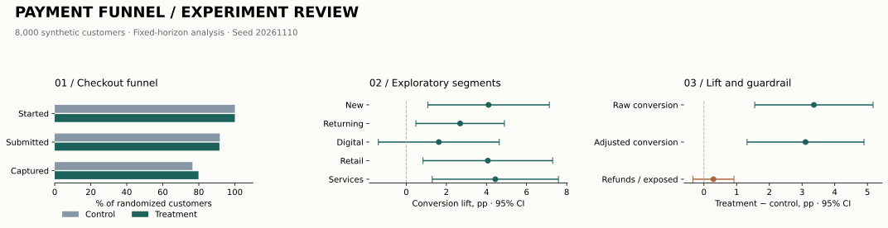

# Payment Funnel Analytics and Experiment Evaluation

More retries can mean more completed payments. They can also mean more refunds. I built this project to put both sides of that tradeoff on the same scorecard.

It follows synthetic customers from checkout to authorization, retry, capture, and refund, then evaluates a change to retry behavior. PostgreSQL queries handle the funnel and cohorts; Python handles the experiment analysis. Tableau-ready exports keep the dashboard setup straightforward.

[Results](results/RESULTS.md) · [Methodology](METHODS.md) · [SQL](sql/funnel.sql) · [Tableau setup](tableau/SETUP.md) · [Tests](tests/test_pipeline.py)



## The short version

Across **8,000 synthetic customers and 30,397 events**, treatment increased conversion from **76.47% to 79.83%**: **+3.36 percentage points**, with a 95% interval of **[+1.55, +5.17] pp**. After regression adjustment, the estimate was **+3.11 pp**.

The catch: the refund guardrail remained inconclusive. Its upper confidence bound exceeded the allowed +0.50 pp deterioration. So the recommendation is **retain control**, despite the conversion win. No free pass just because the headline metric looks good.

These are measured outputs of the seeded synthetic dataset. The [results report](results/RESULTS.md) includes denominators, assumptions, and the full decision logic.

## What’s included

- Checkout-level funnel SQL, authorization sequencing with `ROW_NUMBER` and `LAG`, and weekly cohort views.
- Fixed-horizon A/B evaluation: power planning, sample-ratio mismatch checks, confidence intervals, and a refund non-inferiority guardrail.
- Regression adjustment using pre-treatment covariates with robust standard errors.
- Exploratory customer/merchant segment comparisons and a generated visual scorecard.
- Tableau-ready CSV exports, calculated fields, and a worksheet setup guide.
- Tests for data integrity, retry double-counting, SQL/Python parity, statistics, and the rollout decision.

## Run it

Python 3.11+; run from the repository root.

```bash
python -m pip install -r requirements.txt
python -m src.generate
python -m src.analyze
python -m src.report
python -m unittest discover -s tests -v
```

Generated CSVs stay local to keep the repo lean. `results/metrics.json`, the report, and the SVG preview are checked in. The seed and input hashes make the run reproducible.

## PostgreSQL

With an empty PostgreSQL database and `DATABASE_URL` set:

```bash
psql "$DATABASE_URL" -v ON_ERROR_STOP=1 -f sql/schema.sql
psql "$DATABASE_URL" -v ON_ERROR_STOP=1 -c "\copy customers FROM 'data/customers.csv' CSV HEADER"
psql "$DATABASE_URL" -v ON_ERROR_STOP=1 -c "\copy events FROM 'data/events.csv' CSV HEADER"
psql "$DATABASE_URL" -v ON_ERROR_STOP=1 -f sql/funnel.sql
psql "$DATABASE_URL" -v ON_ERROR_STOP=1 -f sql/cohorts.sql
```

Common SQL logic is exercised locally with SQLite. Native PostgreSQL execution is a separate setup step; the recorded [verification](results/verification.json) states exactly what ran.

## Dashboard handoff

Import `results/cohorts.csv` into Tableau and follow the [setup guide](tableau/SETUP.md). It covers conversion, authorization failures, retry uptake, abandonment, and refunds by cohort and segment. The preview above is generated in Python; this repository ships exports and dashboard instructions rather than a Tableau workbook.

The project stays focused on the analysis: no gateway integration or application backend to babysit.
