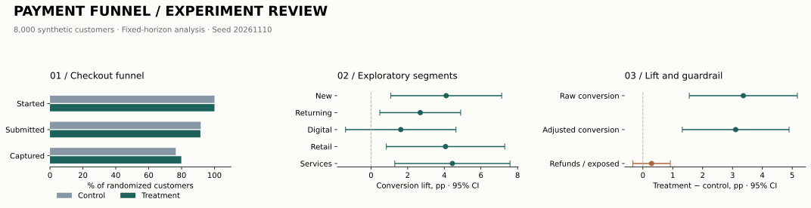

# Experiment results

**Decision: retain control.** Conversion improves in this synthetic run, but the refund guardrail does not establish non-inferiority. A positive conversion result alone is not enough to recommend rollout.

## Scorecard

| Metric | Result |
| --- | ---: |
| Randomized customers | 8,000 |
| Control / treatment | 4,063 / 3,937 |
| Control conversion | 76.47% |
| Treatment conversion | 79.83% |
| Absolute conversion lift | +3.36 pp |
| Conversion 95% CI | [1.55, 5.17] pp |
| Two-sided conversion p-value | 0.000270 |
| Adjusted conversion lift | +3.11 pp |
| Adjusted 95% CI | [1.32, 4.89] pp |
| Sample-ratio mismatch p-value | 0.1589 |
| Refunds / exposed, control | 1.94% |
| Refunds / exposed, treatment | 2.24% |
| Refund lift 95% CI | [-0.34, 0.92] pp |
| Refund non-inferiority margin | +0.50 pp |

## Interpretation

The primary intention-to-treat outcome is capture per randomized customer. All assigned customers remain in the denominator, including those who never submit payment. Treatment changes retry uptake from 30% to 65% after an initial decline in the generator. No other direct treatment effect is encoded.

Regression adjustment uses prior conversion propensity and customer/merchant segments. The treatment coefficient is an adjusted risk difference from an OLS linear probability model with HC1 robust standard errors. It supports the primary unadjusted analysis; it does not establish which segment caused the effect. Segment intervals in the chart are exploratory, unadjusted for multiplicity, and not interaction tests.

SRM passes the predeclared 0.001 threshold. Planning assumed 70% baseline conversion, a 3 pp absolute minimum detectable effect, 80% power, two-sided alpha 0.05, and equal allocation: **3,554 customers per arm**. Both arms exceed that target. This is prospective planning under the stated assumptions, not observed post-hoc power; refund safety may require a larger sample.

The upper bound on refund deterioration is 0.92 pp, above the 0.50 pp margin. Refund non-inferiority therefore remains inconclusive. This does not prove treatment is harmful. The rule uses the upper endpoint of a two-sided 95% interval, a conservative one-sided 97.5% bound.

## Data and measurement

- Seed: 20261110; 8,000 customers; one checkout per randomized customer; 28 days of assignments.
- All data is generated. Results demonstrate the analysis, not a production payment improvement.
- Every captured payment has complete simulated follow-up: refunds occur five days later or never. No right censoring is introduced.
- Abandonment means started without capture, including terminal authorization failures. It is not an inferred browser exit.
- Authorization failure is a checkout-level flag. Retry rate uses checkouts with a failure as denominator, not all event rows.
- Prior conversion is a synthetic pre-treatment propensity feature, not an observed historical conversion rate from a separate dataset.
- Randomization is independent by customer. Real repeated checkouts would need customer-level aggregation or clustered inference.

## Evidence and reproduction

Run `python -m src.generate`, `python -m src.analyze`, then `python -m src.report` from the repository root. Regenerated CSVs feed Tableau and are ignored by Git to keep the repository small.

See [machine-readable results](metrics.json), [test verification](verification.json), [methodology](../METHODS.md), and [Tableau setup](../tableau/SETUP.md). Input SHA-256 digests in metrics.json identify the exact generated CSVs.

The shared SQL aggregation and window queries are executed against SQLite for parity checks. PostgreSQL schema/cohort SQL is supplied for deployment; a native PostgreSQL server and Tableau Desktop were not available in this verification environment.
